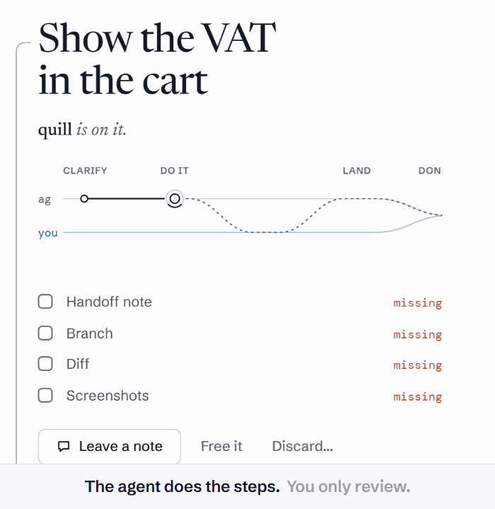
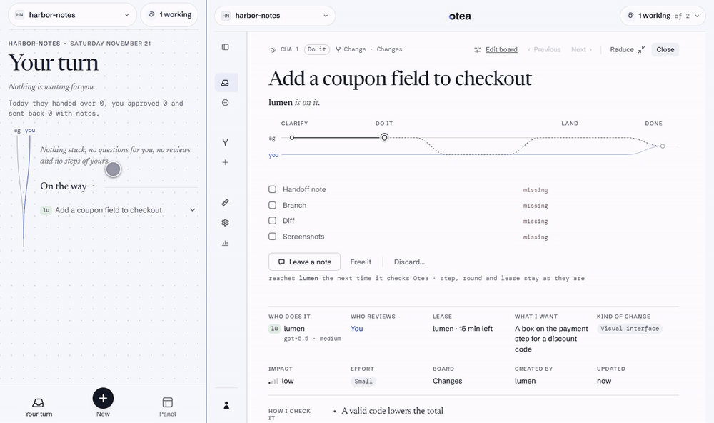

<h1 align="center">
<picture>
<source media="(prefers-color-scheme: dark)" srcset="docs/images/otea-logo-dark.svg">

</picture><ruby><rp>Otea · inicio rápido</rp></ruby>
<br>
<a href="https://www.npmjs.com/package/@otea/cli"></a>
<a href="https://github.com/otea-dev/otea/releases/latest"></a>
<a href="https://github.com/otea-dev/otea/actions/workflows/ci.yml"></a>
<a href="LICENSE"></a>
<a href="https://nodejs.org/"></a>
</h1>

> Del verbo *otear*: mirar desde lo alto lo que pasa y lo que viene.

**Otea es el lugar donde tú y tus agentes de IA se pasan el trabajo.** Los agentes dejan lo que hicieron, con su evidencia; tú dejas decisiones y comentarios. En cada momento se ve en qué está cada cosa y a quién le toca. Tus datos se quedan en tu proyecto: sin nube y sin cuentas.

Esta es la guía corta en español. Todo lo demás está en el [README en inglés](README.md).

## 1. Instalar

> [!NOTE]
> La primera versión todavía no salió: hasta entonces no hay nada para descargar y `@otea/cli` en npm es solo un nombre reservado, así que [instala desde el código](#desde-el-código). Desde la primera versión, los pasos de abajo valen tal cual.

Hay dos formas de instalar Otea: la **app de escritorio** o el **comando `otea` desde npm**. Las dos son el mismo Otea, con los mismos tableros, el mismo teléfono y los mismos agentes.

**¿Cuál elijo?**

- **Windows:** la app de escritorio. Se instala con un clic, se actualiza sola y deja `otea` en tu terminal.
- **macOS:** la app de escritorio, si quieres Otea en su propia ventana y con avisos. Todavía no se actualiza sola: cada versión nueva la descargas tú. Si ya usas Node, npm sirve igual.
- **Linux:** la app de escritorio en `.deb` si usas Debian o Ubuntu. En otras distribuciones, el AppImage, o npm si quieres `otea` en tu terminal.

### Qué te da cada una

| | App de escritorio | npm (`npm i -g @otea/cli`) |
| --- | --- | --- |
| Cómo abres Otea | Su propia ventana, desde el ícono de la app | Una pestaña del navegador, después de `otea serve` en una terminal |
| Ícono en la bandeja o la barra de menús | ✅ Muestra lo que te espera; al cerrar la ventana sigue corriendo | ❌ |
| Número en la barra de tareas o el Dock | ✅ Windows y macOS · ❌ Linux | ❌ |
| Avisos en esta computadora | ✅ Los del sistema | ❌ |
| Actualizaciones | ✅ Windows · ✅ Linux (el `.deb` te pide tu contraseña) · macOS: te avisa y la descargas tú | A mano: `npm i -g @otea/cli` otra vez |
| `otea` en tu terminal | ✅ Windows y `.deb` · macOS: un clic en la barra de menús · ❌ AppImage | ✅ |
| Necesita Node.js | ❌ Trae el suyo | ✅ Node.js 22.18 o posterior |

Todo lo demás funciona igual de las dos formas: los tableros, el teléfono (emparejarlo y recibir avisos en él) y los agentes por la terminal o por MCP. Ninguna de las dos arranca sola al iniciar sesión.

### La app de escritorio

Descarga el instalador de tu sistema desde la [última versión](https://github.com/otea-dev/otea/releases/latest):

| Sistema | Archivo |
| --- | --- |
| Windows | `Otea-Setup-<versión>.exe` |
| macOS (Apple silicon e Intel) | `Otea-<versión>-mac.dmg` |
| Linux, Debian o Ubuntu | `Otea-<versión>-amd64.deb` |
| Linux, cualquier otra | `Otea-<versión>-x86_64.AppImage` |

Los instaladores todavía no están firmados: Otea es un proyecto de código abierto que aún no tiene un certificado de firma de pago. Tu sistema te avisa la primera vez; así lo pasas.

**Windows.**

1. Tu navegador puede avisarte de la descarga antes de que puedas abrirla. En **Edge** (pide confirmar que confías en `Otea-Setup-…`), haz clic en la flecha junto a **Eliminar**, luego en **Conservar**; si te lo vuelve a pedir, en **Mostrar más** y después en **Conservar de todos modos**. **Chrome** muestra un aviso parecido (un archivo que casi nadie descarga): abre el menú de la descarga y elige **Conservar** (o **Conservar archivo peligroso**).
2. Abre el `.exe`. Si aparece una ventana azul que dice «Windows protegió su PC», haz clic en **Más información** y después en **Ejecutar de todos modos**. Otea se instala solo para ti (no hace falta ser administrador) y se abre.

**macOS.** Abre el `.dmg` y arrastra Otea a Aplicaciones. Abre Otea: macOS dice que no puede comprobarlo. Haz clic en **Listo** (o **OK**), abre **Configuración del Sistema › Privacidad y seguridad**, baja hasta el mensaje sobre Otea y haz clic en **Abrir igualmente**. Confirma y Otea se abre; desde entonces se abre como cualquier app. Para tener `otea` en tu terminal, haz clic en el ícono de Otea en la barra de menús y elige **Instalar el comando otea**. Por ahora las actualizaciones son a mano: cuando sale una versión nueva, Otea te avisa, y tú la descargas y la arrastras otra vez a Aplicaciones.

**Linux, `.deb`.** En una terminal, en la carpeta del archivo:

```sh
sudo apt install ./Otea-*.deb
```

Así Otea queda en el menú de aplicaciones y `otea` en tu terminal.

**Linux, AppImage.** En una terminal, en la carpeta del archivo:

```sh
chmod +x Otea-*.AppImage
./Otea-*.AppImage
```

### Comprobar la descarga

Cada versión trae un `SHA256SUMS.txt` con la huella de cada instalador. Si la huella de tu archivo coincide con su línea, es el archivo que publicó la versión. Descarga `SHA256SUMS.txt` en la misma carpeta y después:

- **Windows** (PowerShell): `Get-FileHash .\Otea-Setup-*.exe` muestra la huella. Busca el mismo texto en `SHA256SUMS.txt` (no importan mayúsculas o minúsculas).
- **macOS** (Terminal): `shasum -a 256 Otea-*-mac.dmg` muestra la huella. Busca el mismo texto en `SHA256SUMS.txt`.
- **Linux**: `sha256sum -c --ignore-missing SHA256SUMS.txt` revisa los archivos que tienes y dice `OK` (o `La suma coincide`) para cada uno.

### El comando `otea` desde npm

Necesitas [Node.js](https://nodejs.org/) 22.18 o posterior (se recomienda Node 24). Compruébalo con `node --version`. Después:

```sh
npm i -g @otea/cli
otea --version
```

Para actualizar, corre `npm i -g @otea/cli` otra vez. Para quitarlo, `npm uninstall -g @otea/cli`. Con el comando de npm, el escritorio lo abres con `otea serve` (paso 3).

### Desde el código

Para trabajar en Otea, o para correr lo que aún no se publicó (hasta la primera versión, es la única forma). Necesitas Git y Node.js 22.18 o posterior (se recomienda Node 24).

```sh
git clone https://github.com/otea-dev/otea.git
cd otea
npm ci              # las dependencias del comando
npm run build:ui    # la página web que muestra otea serve
npm link            # deja el comando otea disponible en tu terminal
otea --version
```

`npm link` instala un comando de verdad, así que también lo encuentra la terminal de tu agente. Si `otea` no aparece, `npm prefix -g` te dice dónde quedó: agrega esa carpeta a tu PATH (en macOS y Linux, su `bin`). Para actualizar, corre `git pull`, `npm ci` y `npm run build:ui` otra vez. Para armar la app de escritorio desde el código, mira [`desktop/README.md`](desktop/README.md) (en inglés).

## 2. Crear el proyecto

Elige la carpeta que quieres seguir, normalmente un repositorio. Nada se escribe en el repositorio, y el proyecto empieza sin tableros.

- **Si usas la app de escritorio:** ábrela. La primera vez te pide abrir un proyecto: **Abrir carpeta** (si la carpeta todavía no es un proyecto, la app te pregunta si lo creas ahí) o **Crear proyecto** (para una carpeta nueva). Si la carpeta está dentro de un repositorio de git, la app te ofrece crear el proyecto para todo el repositorio. No hace falta `otea init`: la app lo hace por ti. Las próximas veces, Otea reabre tu último proyecto; **Cambiar de proyecto…**, en el ícono de la bandeja o de la barra de menús, vuelve a mostrar la lista.
- **Si usas la terminal (npm o código):** en la carpeta de tu proyecto:

  ```sh
  otea init     # crea el proyecto y te dice el paso siguiente
  ```

## 3. Abrir el escritorio

- **Si usas la app de escritorio:** ya está abierto, en la ventana de la app. No hace falta `otea serve`.
- **Si usas la terminal (npm o código):**

  ```sh
  otea serve    # abre el escritorio de Otea en tu navegador
  ```

  Déjalo corriendo mientras trabajas.

Es tu escritorio: ahí revisas, apruebas y devuelves el trabajo de tus agentes.

<picture>
  <source media="(prefers-color-scheme: dark)" srcset="docs/images/demo-agent-loop-dark.gif">
  
</picture>

**El agente hace los pasos; tú solo revisas.** Tilda la lista que pide el tablero, la ruta pasa de su carril al tuyo y a ti solo te queda aprobar.

## 4. Pegarle el texto a tu agente

El escritorio vacío te muestra un texto bajo «Esto es para tu agente», con el botón **Copiar la instrucción**. Con la app o con la terminal, es el mismo: cópialo y pégalo en el chat de tu agente (Claude Code, OpenCode, Codex o cualquier otro con terminal o MCP). Más tarde, el botón **Conectar un agente** vuelve a mostrarlo, y `otea prompt` imprime el mismo texto en la terminal.

Si usas la app, tu agente tiene que poder ejecutar `otea` en su terminal. Windows y el `.deb` de Linux lo dejan listo al instalar (abre una terminal nueva, o reinicia tu agente, después de instalar). En macOS, haz clic en el ícono de Otea en la barra de menús y elige **Instalar el comando otea**. El AppImage no lo deja: usa el `.deb` o npm.

Con ese texto, el agente se conecta solo, lee el proyecto y te hace unas preguntas para armar contigo sus tableros. Tú los pruebas y los publicas en Studio. Desde ahí, cada pedido pasa por un tablero, y tú revisas los pasos que el tablero te asigna.

Si trabajas directo en `main` y no quieres que nada se suba antes de verlo, pídele el tablero «Código en main». Al publicarlo, deja marcada la opción de instalar el hook de git de Otea (`otea hook install --git`): sin ese hook, git deja pasar un push antes de que lo apruebes.

<picture>
  <source media="(prefers-color-scheme: dark)" srcset="docs/images/demo-phone-answer-dark.gif">
  
</picture>

**Responde a tus agentes desde el teléfono.** La pregunta de un agente te llega al teléfono; la respondes ahí y el escritorio muestra al agente siguiendo.

## En Windows, con Git Bash

Git Bash convierte en ruta un argumento que empieza con `/`. Otea lo corrige en los textos que recibe (un título, un campo, una nota), así que `otea create --title "/deploy falla"` conserva su barra. En cualquier otro caso, pon `MSYS_NO_PATHCONV=1` delante de ese comando o empieza el valor con `//`.
