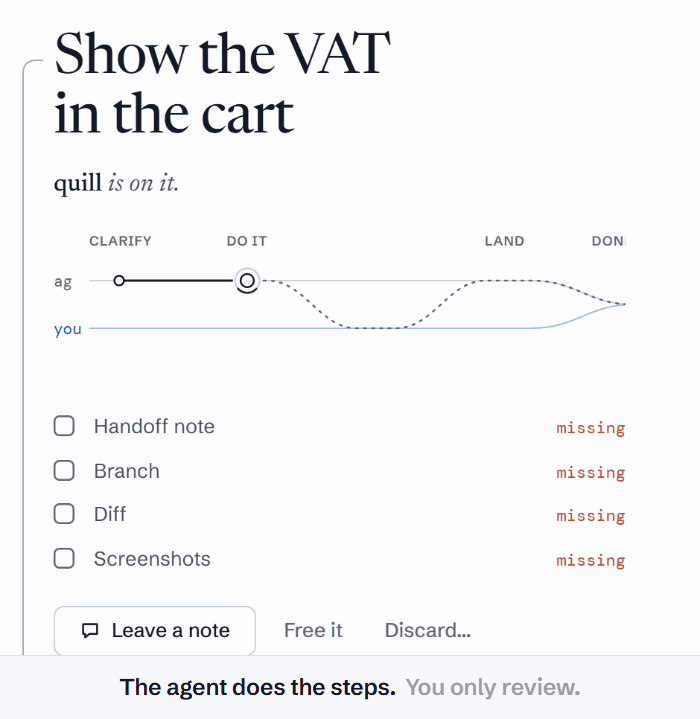
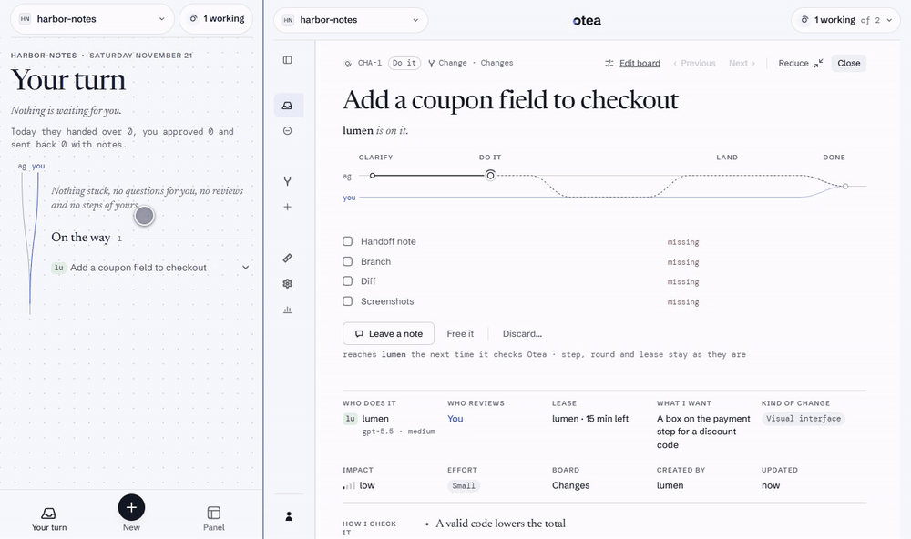

<h1 align="center">
<picture>
<source media="(prefers-color-scheme: dark)" srcset="docs/images/otea-logo-dark.svg">

</picture><ruby><rp>Otea</rp></ruby>
<br>
<a href="https://www.npmjs.com/package/@otea/cli"></a>
<a href="https://github.com/otea-dev/otea/releases/latest"></a>
<a href="https://github.com/otea-dev/otea/actions/workflows/ci.yml"></a>
<a href="LICENSE"></a>
<a href="https://nodejs.org/"></a>
</h1>

**A local board where your AI agents hand you their work, and you hand back decisions, without keeping their sessions open.**

¿Hablas español? Lee el [inicio rápido en español](README.es.md).

> From the Spanish verb *otear*: to scan from a high vantage point, to watch what is happening and what is coming.

Agents produce work faster than a human can follow it live. Otea is where work changes hands: agents leave findings, deliverables and evidence; you leave decisions and feedback; both can see at any moment where each thing stands and whose turn it is.

**The handoff lives in the item, not in the session.** Evidence, history and the next step are stored with the item, so an agent can hand it over and its session can close instead of sitting open waiting for you. Any later session picks it up from `otea show`, whose `Next:` line says what to do now, and `otea wait` blocks until an item is the agent's turn again. A lease the closed session held expires on its own.

- **Triage** many findings at once: filter, group, prioritize, discard.
- **Review** results in depth: GIFs, video, diffs, logs, with concrete questions the agent reads back and acts on.
- **Boards** shape the work: their steps, who does and reviews each, what a handoff carries. **Templates** start a board, or several joined boards at once (a Cambio that divides into one Tarea de repo per repository).
- **Local-first**: data stays with your project. No cloud, no accounts.
- **Harness-neutral**: any agent with a shell (CLI) or MCP support can use it.
- **Traceable**: every change is an append-only event, with who made it and through which channel.

<picture>
  <source media="(prefers-color-scheme: dark)" srcset="docs/images/demo-agent-loop-dark.gif">
  
</picture>

**The agent does the steps; you only review.** It ticks the checklist the board asks for, the route moves from its lane to yours, and all that is left for you is Approve.

<picture>
  <source media="(prefers-color-scheme: dark)" srcset="docs/images/desk-your-turn-dark.png">
  
</picture>

**Your turn**, the desk's first page: what waits for you, and what the agents are on.

<picture>
  <source media="(prefers-color-scheme: dark)" srcset="docs/images/desk-review-dark.png">
  
</picture>

A change under review, with the evidence its step asked for: the diff and before-and-after screenshots.

<picture>
  <source media="(prefers-color-scheme: dark)" srcset="docs/images/phone-review-dark.png">
  
</picture>

The same change on a phone, with the agent's note and your two moves.

<picture>
  <source media="(prefers-color-scheme: dark)" srcset="docs/images/demo-phone-answer-dark.gif">
  
</picture>

**Answer your agents from your phone.** A question from an agent reaches your phone; you answer there, and the desk shows the agent going on.

## Status

Early: version 0.1.0 is out and usable, and still changing fast. The product definition lives in [`docs/otea-product-definition.md`](docs/otea-product-definition.md).

## Install

There are two ways to install Otea: the **desktop app**, or the **`otea` command from npm**. Both are the same Otea, with the same boards, phone and agents.

**Which one?**

- **Windows:** the desktop app. One click installs it, it updates itself and it puts `otea` in your terminal.
- **macOS:** the desktop app, if you want Otea in its own window with notifications. It cannot update itself yet: you download each new version. If you already use Node, npm is just as good.
- **Linux:** the desktop app as a `.deb` on Debian or Ubuntu. On other distributions, the AppImage, or npm if you want `otea` in your terminal.

### What each one gives you

| | Desktop app | npm (`npm i -g @otea/cli`) |
| --- | --- | --- |
| How you open Otea | Its own window, from the app icon | A tab in your browser, after `otea serve` in a terminal |
| Icon in the tray or menu bar | ✅ Shows what waits for you; closing the window keeps it running | ❌ |
| Count on the taskbar or Dock | ✅ Windows and macOS · ❌ Linux | ❌ |
| Notifications on this computer | ✅ The system's own | ❌ |
| Updates | ✅ Windows · ✅ Linux (the `.deb` asks for your password) · macOS: it tells you, you download it | By hand: `npm i -g @otea/cli` again |
| `otea` in your terminal | ✅ Windows and `.deb` · macOS: one click in the menu bar · ❌ AppImage | ✅ |
| Needs Node.js | ❌ It brings its own | ✅ Node.js 22.18 or later |

Everything else works the same both ways: boards, the phone (pairing and notifications on it), agents over the CLI or MCP. Neither starts on its own when you log in.

### The desktop app

Download the installer for your system from the [latest release](https://github.com/otea-dev/otea/releases/latest):

| System | File |
| --- | --- |
| Windows | `Otea-Setup-<version>.exe` |
| macOS (Apple silicon and Intel) | `Otea-<version>-mac.dmg` |
| Linux, Debian or Ubuntu | `Otea-<version>-amd64.deb` |
| Linux, any other | `Otea-<version>-x86_64.AppImage` |

The installers are not signed yet: Otea is an open-source project without a paid signing certificate so far. Your system warns you the first time; here is how to get past it.

**Windows.**

1. Your browser may warn about the download before you can open it. In **Edge** ("Make sure you trust Otea-Setup-… before you open it", Publisher: Unknown), click the arrow next to **Delete**, then **Keep**; if it asks again, **Show more**, then **Keep anyway**. **Chrome** shows a similar "not commonly downloaded" warning: open the download's menu and choose **Keep** (or **Keep dangerous file**).
2. Open the `.exe`. If a blue window says "Windows protected your PC", click **More info**, then **Run anyway**. Otea installs for you alone (no administrator needed) and opens.

**macOS.** Open the `.dmg` and drag Otea to Applications. Open Otea: macOS says it cannot check it. Click **Done** (or **OK**), then open **System Settings › Privacy & Security**, scroll down to the message about Otea and click **Open Anyway**. Confirm, and Otea opens; from then on it opens normally. To have `otea` in your terminal, click the Otea icon in the menu bar and choose **Install the otea command**. Updates are manual for now: when a new version is out, Otea tells you, and you download it and drag it to Applications again.

**Linux, `.deb`.** In a terminal, in the folder with the file:

```sh
sudo apt install ./Otea-*.deb
```

This puts Otea in your apps menu and `otea` in your terminal.

**Linux, AppImage.** In a terminal, in the folder with the file:

```sh
chmod +x Otea-*.AppImage
./Otea-*.AppImage
```

### Check your download

Each release has a `SHA256SUMS.txt` with a fingerprint of every installer. If your file's fingerprint matches its line, it is the file the release published. Download `SHA256SUMS.txt` to the same folder, then:

- **Windows** (PowerShell): `Get-FileHash .\Otea-Setup-*.exe` prints the fingerprint. Find the same text in `SHA256SUMS.txt` (case does not matter).
- **macOS** (Terminal): `shasum -a 256 Otea-*-mac.dmg` prints the fingerprint. Find the same text in `SHA256SUMS.txt`.
- **Linux**: `sha256sum -c --ignore-missing SHA256SUMS.txt` checks the files you have and says `OK` for each.

### The `otea` command from npm

You need [Node.js](https://nodejs.org/) 22.18 or later (Node 24 recommended). Check with `node --version`. Then:

```sh
npm i -g @otea/cli
otea --version
```

To update, run `npm i -g @otea/cli` again. To remove it, `npm uninstall -g @otea/cli`. You open the desk with `otea serve` (see [Get started](#from-the-terminal-npm-or-source)).

### From source

To work on Otea, or to run what is not released yet. If you only want to use Otea, the desktop app or npm above is simpler. It takes Git and Node.js 22.18 or later (Node 24 recommended):

```sh
git clone https://github.com/otea-dev/otea.git
cd otea
npm ci              # the CLI's dependencies
npm run build:ui    # the web UI that otea serve shows
npm link            # puts the otea command on your PATH
otea --version
```

`npm link` installs a real command, not an alias: a symlink in npm's global `bin` on macOS and Linux, and `otea.cmd`, `otea.ps1` and a shell script in npm's global folder on Windows. Every shell finds it, so an agent's own shell (Claude Code's, OpenCode's, a script's) runs `otea` the same as your terminal. Run `npm prefix -g` to see where it went; if `otea` is not found, add that folder (on macOS and Linux, its `bin`) to your PATH. To update, `git pull`, `npm ci` and `npm run build:ui` again; `npm unlink -g @otea/cli` takes the command away. To build the desktop app from source, see [`desktop/README.md`](desktop/README.md).

### On Windows, in Git Bash

Git Bash turns an argument that starts with `/` into a path (`/deploy` reaches Otea as `C:/Program Files/Git/deploy`). Otea undoes it for the text it is given (a title, a field, a note), so `otea create --title "/deploy fails"` keeps its slash. Anywhere else, set `MSYS_NO_PATHCONV=1` for that command, or start the value with `//`.


## Get started

Which steps you follow depends on how you installed Otea. Both paths end at the same place: the desk, with the text to give your agent.

### With the desktop app

You do not run `otea init` or `otea serve`: the app does both for you.

1. **Open Otea and pick the project folder.** The first time, the app asks you to open a project:
   - **Open folder** picks a folder that is already an Otea project. If it is not one yet, the app asks "Create one there?" and makes it when you say yes.
   - **Create project** picks the folder for a new project.

   Choose the folder you want to track, usually a repository. If it is inside a git repository, the app offers to create the project for the whole repository. Creating the project writes nothing into the repo, and it starts with no boards (what your agent's `otea connect` adds later is in [What Otea writes in your repo](#what-otea-writes-in-your-repo)). The next times, Otea reopens your last project; **Switch project…** in the tray or menu bar icon brings the picker back.

2. **The desk opens in the app's window.** A project with no boards starts on **Your turn**, with a text for your agent and a **Copy the instruction** button. The **Connect an agent** button shows the same text later.

3. **Check that your agent can run `otea`.** The text has your agent run `otea` commands, so `otea` has to be in its terminal. Windows and the Linux `.deb` set that up when they install (open a new terminal, or restart your agent, after installing). On macOS, click the Otea icon in the menu bar and choose **Install the otea command**. The AppImage does not set it up: use the `.deb` or npm.

Then [give your agent the text](#give-your-agent-the-text).

### From the terminal (npm or source)

1. **Make the project.** In the folder you want to track, usually a repository:

   ```sh
   otea init
   ```

   It says where the project's data lives and what to do next:

   ```text
   Project data in ~/.otea/data/tienda-web-yafrhx
   Next: run otea serve in a terminal of your own, or open the Otea desktop app: the desk gives you the text to paste into your agent's chat (otea prompt prints it here).
   ```

   `otea init` writes nothing into the repo, and the project starts with no boards (`otea init --agents-md` and your agent's `otea connect` add one block to `AGENTS.md`: see [What Otea writes in your repo](#what-otea-writes-in-your-repo)).

2. **Open the desk.** In a terminal of your own, and leave it running:

   ```sh
   otea serve
   ```

   It prints `Otea running at http://127.0.0.1:4400/p/tienda-web-yafrhx/` and opens the desk in your browser, signed in. A project with no boards opens on **Your turn** with a text for your agent and a **Copy the instruction** button.

### Give your agent the text

Both paths meet here. Paste the text into your agent's chat (Claude Code, OpenCode, Codex or any other with a shell or MCP); `otea prompt` prints the same text in a terminal. The agent connects itself, reads the project, asks you one question at a time how you work and drafts its boards. You try them and publish them in Studio. From then on each request goes through a board, and what waits for you shows in **Your turn**.

### MCP config for your harness

An agent over MCP adds Otea's server to its own harness, for this project only. `otea connect` prints the exact `command`, `args` and `env` to use. Copy them as printed: the `otea` on your `PATH` when it is the same install as the one running `connect`, otherwise the absolute paths of the running one, with a warning line saying which `otea` is on `PATH`. The same entry in the config shape of three harnesses, shown for the desktop app (one leading arg, and the `env` that makes its Electron run as Node; without it the app opens its window instead of the server). From npm or a checkout `connect` prints `--disable-warning=ExperimentalWarning` before the main path, and prints `env` only when you set `OTEA_HOME`; with `otea` on `PATH`, the command is `otea` and the args are `mcp --project <id>`.

- Cursor, in `.cursor/mcp.json` of the project:

  ```json
  {
    "mcpServers": {
      "otea": {
        "command": "<command>",
        "args": ["<main>", "mcp", "--project", "<project-id>"],
        "env": { "<NAME>": "<value>" }
      }
    }
  }
  ```

- VS Code, in `.vscode/mcp.json` of the project:

  ```json
  {
    "servers": {
      "otea": {
        "type": "stdio",
        "command": "<command>",
        "args": ["<main>", "mcp", "--project", "<project-id>"],
        "env": { "<NAME>": "<value>" }
      }
    }
  }
  ```

- Antigravity, in `.agents/mcp_config.json` of the workspace (its [MCP docs](https://antigravity.google/docs/mcp/)); the global `~/.gemini/config/mcp_config.json` applies to every project, so the server there would point at one project only. The IDE opens the file from its MCP settings, View raw config.

  ```json
  {
    "mcpServers": {
      "otea": {
        "command": "<command>",
        "args": ["<main>", "mcp", "--project", "<project-id>"],
        "env": { "<NAME>": "<value>" }
      }
    }
  }
  ```

On Windows write the paths with `/` or doubled `\\` inside JSON. Then reload the harness and run `otea connect --check`.

## Everyday commands

| You run | What it does |
| --- | --- |
| `otea init` | makes the project for this folder |
| `otea serve` | opens the desk in your browser |
| `otea prompt` | prints the text to paste into an agent's chat |
| `otea board add <name> --template <key>` | adds a board from a template, published at once |
| `otea topic on` | has agents keep the side questions you ask them, with their answers |
| `otea devices list` | lists the paired phones; `otea devices revoke <id>` unpairs one |
| `otea hook install --git` | in a repo: a pre-push hook that checks each push against the boards |
| `otea uninstall --dry-run` | lists what removing Otea from your repos and this computer would touch; `otea uninstall` does it |

| Agents run | What it does |
| --- | --- |
| `otea next` | says which item to take now and what its step asks |
| `otea claim <id>` | holds the item for this step, so no other agent writes it |
| `otea handoff <id>` | hands the step on, refused until it carries what the step asks |
| `otea wait --turn agent --unclaimed` | blocks until there is work, then `otea next` again |

`otea help` lists every command, and `otea <command> --help` its options; the [docs](#docs) go into each part.

## Upgrade and remove

### Upgrade

```sh
otea --version          # the version you run now
npm i -g @otea/cli      # npm: installs the latest
```

- **npm:** run `npm i -g @otea/cli` again. Once a day, when you run `otea` in a terminal, it asks the npm registry whether there is a newer version and prints one line if there is. It never runs in CI, under `--json`, in a pipe, for an agent (`--as` or `OTEA_AGENT`), for the MCP server, the hook or `otea uninstall`, waits at most about a second, and says nothing offline. `OTEA_NO_UPDATE_CHECK=1` turns it off. The answer is kept in `update-check.json` in the Otea home.
- **Desktop app:** Windows and Linux (`.deb`) update themselves; on macOS you download each new version. The app does not run the check above.
- Your projects, boards and history live in the Otea home (`~/.otea`, or `$OTEA_HOME`), and an upgrade keeps them.

### What Otea writes in your repo

| What | Written by | Removed by |
| --- | --- | --- |
| A block in `AGENTS.md`, between `<!-- otea:begin -->` and `<!-- otea:end -->`, that points to `otea board`: it holds no copy of the guide | `otea connect`, `otea init --agents-md` (and `connect` says so each time it writes it) | `otea uninstall` |
| The `pre-push` hook (in `.git/hooks`, or where `core.hooksPath` points), marked `# otea-hook` | `otea hook install --git` | `otea uninstall`, or `otea hook remove --git` |
| `.otea/` in the repo, and a line `.otea/` in `.git/info/exclude` | `otea init --local` | `otea uninstall --purge-data` deletes `.otea/`; the `.git/info/exclude` line stays (it is inside `.git`, never committed, and harmless: delete the line by hand if you want it gone) |
| Hooks and allow rules in `.claude/settings.local.json` that an older Otea wrote | an older `otea hook install --claude` | `otea uninstall` |

`otea init` in the default storage and the desktop app write nothing in the repo. Otea writes no harness config: if you added its MCP server to an agent's own config, remove it there.

### Remove

```sh
otea uninstall --dry-run   # lists every repo and file it would touch, and changes nothing
otea uninstall             # takes the hook and the AGENTS.md block out of every repo, and stops the background server
```

`otea uninstall` goes through the repo you are in and every repo or folder the registry links to a project (`otea projects list`), and leaves each as it was before `otea init`: it removes only what is exactly Otea's: a pre-push hook that holds nothing but the lines Otea writes, and an `AGENTS.md` block that is the one Otea writes, once, between its markers. A hook you edited or added to, another pre-push hook, markers that are repeated or have your text inside them, and every other line of `AGENTS.md` stay, and it says so; `AGENTS.md` is deleted only when nothing else is in it. It says what it removed, which registered folder no longer exists, and any folder it could not clean (it goes on with the others, and exits 1). It stops this Otea home's background server (`otea serve start`) by its process id. `--only repos` or `--only machine` does one half.

It does not touch your data. To delete the Otea home and the repo's `.otea/` too (every project, board and item in them, with no way back), add `--purge-data`: it asks you to type `yes` (`--yes` answers for a script). It stops the background server first, whatever `--only` says, refuses if it cannot, and only deletes a folder that holds Otea's registry and is not a filesystem root, your home folder or a folder holding where you run it. A GitHub ruleset from `otea hook install --forge` is removed with `otea hook remove --forge`, before the command is gone.

Then remove the command itself:

- **npm:** `npm uninstall -g @otea/cli` (`npm unlink -g @otea/cli` if you ran `npm link`).
- **Windows:** Settings > Apps > Otea > Uninstall. **macOS:** drag Otea out of Applications. **Linux:** `sudo apt remove otea-desktop`, or delete the AppImage.

## Why Otea, and when not

An issue tracker or a TODO.md holds what to do. Otea also holds how, and checks it:

- **The board is the procedure.** An agent reads each step's instructions from the board (`otea next`), not from a prompt you repeat in every session.
- **Handoffs carry evidence.** The diff, the screenshots, the test output or the recording come with the item, and you review them there.
- **A gate checks what an agent can push.** The pre-push hook lets a branch through only while its item's step allows it, and a base branch the board protects only once you approved.

When not to use it:

- You pair live with one agent and never step away: the chat already is the handoff.
- You need cloud sync or accounts: Otea is local-first, and its data stays on your computer.
- You need a signed installer: Otea's installers are not signed yet.

## Help

Questions and bugs go to [GitHub Issues](https://github.com/otea-dev/otea/issues). Report a security problem privately, as [SECURITY.md](SECURITY.md) says.

## License

Otea is free software under the [GNU Affero General Public License v3.0](LICENSE). You can use, study, modify and share it. If you distribute a modified version, or let people use it over a network, you must publish its source under the same license, keeping the copyright notices.

**Using Otea inside a company.** Running it, unmodified or modified, on your own team's computers for your own work asks nothing of you, as long as you do not distribute it or offer it as a network service to people outside your organization. The AGPL's duties start when you give copies to others, or let others use your modified version over a network. That is a plain reading of the license, not legal advice: [SECURITY.md](SECURITY.md#using-otea-inside-a-company-the-agpl) has the detail, and the [license](LICENSE) is what governs.

**Commercial license.** If the AGPL does not fit your use (for example, embedding Otea in a closed product), a commercial license is available. Open an issue or contact Federico Daniel Ara ([@Lartweib](https://github.com/Lartweib)).

**Name.** "Otea" and its logo identify this project. Forks are welcome under the AGPL, but must use a different name.

Contributions are accepted under the [Contributor License Agreement](CLA.md); see [CONTRIBUTING.md](CONTRIBUTING.md).

## Docs

- [Working with agents](docs/working-with-agents.md): the commands agents run, leases, relaying a decision, waiting and events, the guide, profiles and stats, what to paste into an agent's chat, and what your harness must allow.
- [MCP](docs/mcp.md): working from an MCP client, `otea connect` and the tools.
- [Projects](docs/projects.md): where a project lives, the files Otea writes in the repo, linking several repos, and moving a local project to common storage.
- [Evidence](docs/evidence.md): attaching files as proof, and how the item page draws them.
- [Relations](docs/relations.md): parents, blockers and the other links between items.
- [Boards](docs/boards.md): templates, the Matrix, boards that divide into others, an agent drafting a board, archiving, and the moves and git gates of agents.
- [Topics](docs/topics.md): the side questions agents keep as short conversations.
- [The desk](docs/desk.md): `otea serve`, the web UI, and its API for agents at work and notes.
- [Several projects and a phone](docs/phone.md): one server for every project, the phone on the local network or Tailscale, and notifications.
- [Security and data](docs/security.md): where Otea keeps its data, what listens and where, what leaves the machine, what it writes in your repos, and how to remove it.
- [Development](docs/development.md): tests, `npm run dev:ui` and the token budget.
